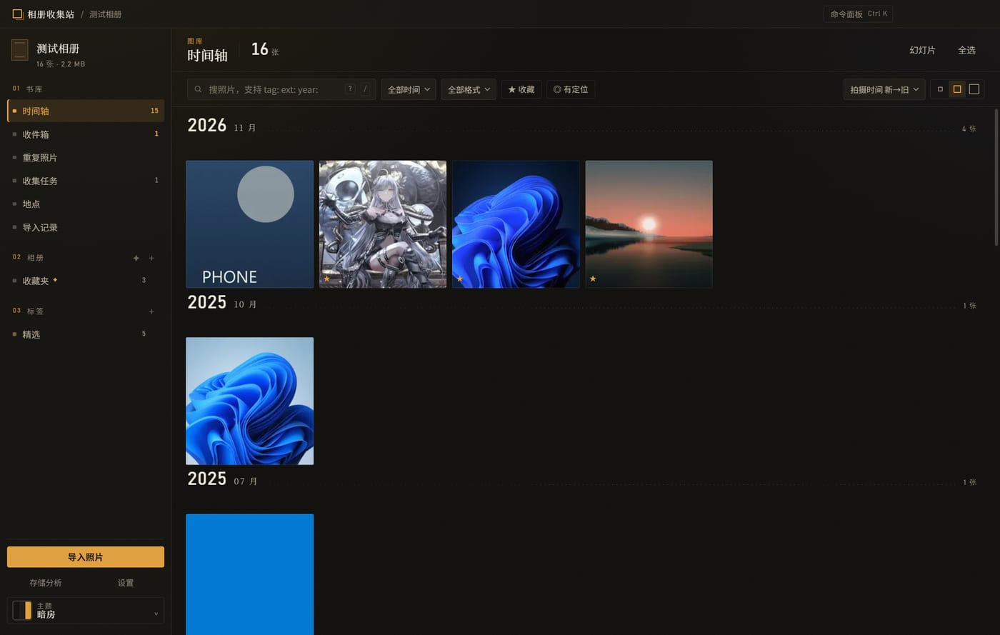
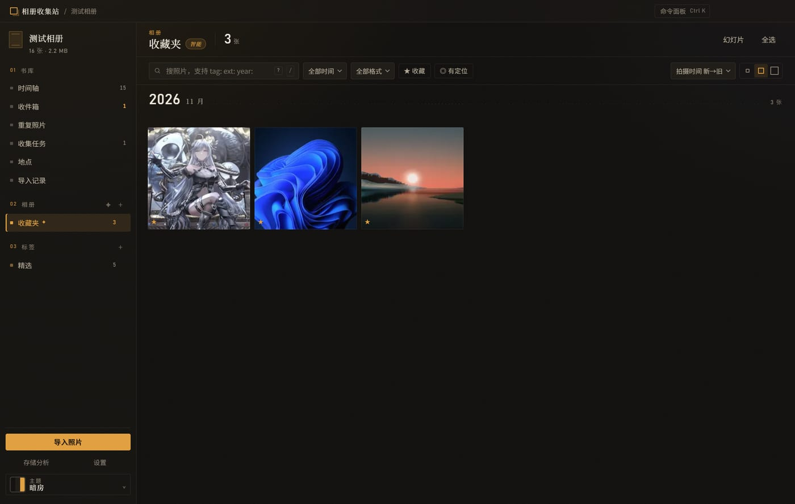
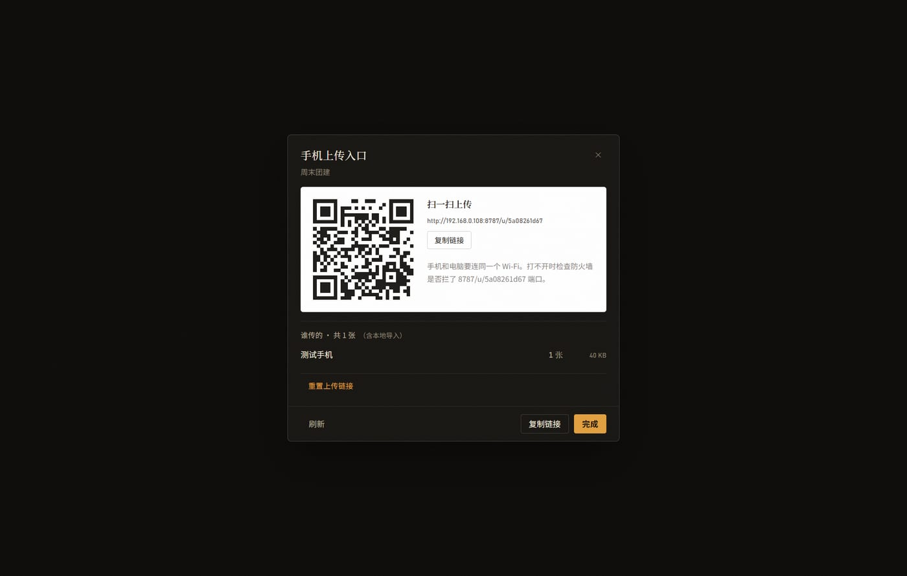

# 相册收集站 · PhotoVault

本地优先的照片收集与整理工具。把散落在硬盘、相机卡、手机里的照片收拢到一个看得见的地方——**不复制原图，不上传云端，不改动你的文件**。



## 为什么做这个

手机相册、相机卡、微信下载、各种备份盘，照片散在十几个目录里，想找某一张就得挨个翻。云相册要么按月收费，要么传上去就再也拿不下来。

相册收集站只做两件事：

1. **收拢**：把各处的照片扫进一个索引里，按拍摄时间排好；
2. **不越界**：只记录路径、哈希和缩略图，原图留在原地，删了索引也不影响文件。

## 功能

| 阶段 | 能力 |
| --- | --- |
| 收集 | 目录导入（递归子目录）、拖拽导入、手机扫码上传（同一 Wi-Fi，浏览器直传，不装 App）、收件箱先审后入库、导入记录可整批回滚 |
| 整理 | sha1 全文件去重、相似照片聚类、时间轴按年月分组（虚拟滚动）、层级标签 + 颜色、手动相册 / 智能相册（规则自动归集）、批量重命名（模板 + 结果与预览逐条一致）、地点聚合、收藏 / 隐藏 / 淘汰状态 |
| 交付 | 批量导出（转格式、限尺寸、调质量）、离线 HTML 相册（带图片副本，双击就能看，不依赖本程序）、幻灯片、存储分析（按年份 / 类型 / 体积） |
| 体验 | 4 套主题（暗房 / 银盐 / 红灯 / 画廊）、命令面板 `Ctrl+K`、快捷键表 `?`、右键菜单、选中态批量操作条 |

<p align="center">
  
  
</p>

## 设计取舍

- **索引不搬家**：媒体库里只新增 `<库>/.vault/`（`vault.db` + `thumbs/` + `uploads/`），原图一张都不动。所以「删库」是安全的，删除 `.vault` 就等于彻底卸载，照片还在。
- **去重靠内容**：对整份文件算 sha1，不靠文件名或大小。同一个文件换个名字再拖进来，会被识别为重复并跳过。
- **不用 better-sqlite3**：那个模块要按 Electron ABI 重编译，官方也没出 Electron 45 的预编译包。Electron 45 内置的 `node:sqlite` 够用，免编译、打包更小——代价是没有 `.pragma()` 和 `.transaction()`，在 `src/main/db/sqlite.ts` 这一层手动补上。
- **更新检查不装框架**：`electron-updater` 要做「下载 → 校验 → 静默替换 → 重启」，Windows 上还得配签名，任何一环出错用户只看到一个装不上的黑盒。这里改成查 GitHub Releases 的 latest，查到就把下载页和更新说明摆出来，装不装由人决定。

## 技术栈

| 层 | 选型 |
| --- | --- |
| 壳 | Electron 45 |
| 界面 | React 19 + TypeScript 5.9 + zustand 5 + @tanstack/react-virtual |
| 构建 | electron-vite 6（Vite 7）+ electron-builder 26 |
| 数据 | `node:sqlite`（内置）+ 12 张表，无 ORM |
| 媒体 | sharp（缩略图 / 转码 / 导出）、exifr（EXIF）、qrcode（上传二维码） |

进程按三层分：`src/main`（主进程，全部文件与数据库操作）、`src/preload`（只暴露白名单 API）、`src/renderer`（纯 UI，不碰 Node）。渲染层拿不到 `fs`，所有能力都走 65 个 IPC 通道，接口定义收在 `src/shared/ipc.ts`。

## 开发

开发与验证环境：Windows 11 + Node 22（Electron 45 内置的 Node 与之一致）。

```bash
npm install
npm run dev        # 开发模式，热更新
npm run typecheck  # 两套 tsconfig（node / web）分别检查
npm run build      # 编译到 out/
```

| 命令 | 说明 |
| --- | --- |
| `npm run dev` | electron-vite 开发模式 |
| `npm run build` | 编译主进程 / preload / 渲染层到 `out/` |
| `npm run typecheck` | 类型检查，零报错是提交前提 |
| `npm run seed` | 生成测试图片到 `_data/` |
| `npm run e2e` | 对已启动的实例跑端到端断言（需先 `build`） |
| `npm run e2e:full` | 起干净实例 → 跑完整 e2e → 收摊，一条命令 |
| `npm run dist` | 编译 + 打 Windows 安装包到 `dist/` |

也支持 pnpm（11.x）。仓库里的 `pnpm-workspace.yaml` 已经把需要跑 postinstall 的包写进 `allowBuilds`——pnpm 11 会把「依赖的构建脚本没被批准」当成硬错误（`ERR_PNPM_IGNORED_BUILDS`，install 直接 exit 1），少了这份配置 `pnpm dev` 会在校验依赖时直接失败。国内网络如果卡在 Electron 二进制下载，先设 `ELECTRON_MIRROR=https://npmmirror.com/mirrors/electron/`。

CI 用的是 npm（`npm ci` + `package-lock.json`），pnpm 只是本地开发的可选入口。

## 目录结构

```
src/
  main/           主进程
    db/           sqlite 封装、schema、各实体的 repo
    media/        扫描、缩略图、去重、重命名、导出、HTML 相册
    import/       导入流水线（进度、取消、回滚）
    upload/       局域网 HTTP 上传服务 + 手机端页面
    ipc/          通道注册
  preload/        白名单 API 注入
  renderer/       React 界面
    pages/        时间轴、收件箱、重复、任务、地点、导入记录、存储、设置
    components/   网格、查看器、侧栏、命令面板、幻灯片…
    dialogs/      导出、重命名、上传、智能相册…
  shared/         主进程与渲染层共用：IPC 契约、搜索语法、媒体类型
test/             e2e（CDP 驱动真实 Electron）+ 种子数据
docs/             设计稿与截图
```

## 库目录里有什么

选了某个文件夹作为媒体库之后，只会多出下面这一块：

```
我的照片/
  IMG_0001.jpg          ← 原图，原封不动
  .vault/
    vault.db            索引：路径、sha1、EXIF、标签、相册、任务…
    thumbs/             WebP 缩略图，可随时清缓存重建
    uploads/            手机上传的暂存区
    收集/<任务名>/       收集任务按任务名落盘，方便直接翻文件夹
```

备份只需要备份原图；`.vault` 丢了重新导入一遍即可重建。

## 测试

`npm run e2e:full` 会起一个独立的 Electron 实例（单独的 user-data，不碰你正在用的库），通过 CDP 驱动真实界面，覆盖 30 项断言：导入去重、收件箱审核、标签与筛选、智能相册、收集任务、手机上传（真起 HTTP 服务、真取上传页、真入库）、相似聚类、批量重命名、导出压缩、离线相册页、存储分析，最后检查控制台无报错。

启动脚本会清空 `_lib/`、`_out/` 和测试用的 user-data——**别把真实媒体库放在 `_lib` 下面**。

## 打包

```bash
npm run dist
```

产物：`dist/PhotoVault-<version>-setup.exe`（NSIS，中文安装向导，可选安装目录，不强制提权）。配置在 `electron-builder.yml`：`sharp` 是原生模块，走 `asarUnpack` 解包，避免 asar 内加载失败。目前只配置了 Windows x64 目标。

## 更新与发布

### 客户端怎么查更新

设置页的「检查更新」直接查 GitHub Releases 的 latest：

- 接口：`GET https://api.github.com/repos/FightZhanAng/photo-vault/releases/latest`
- 只认**正式发布**（草稿和预发布不算）；tag 上的 `v` 前缀会去掉再比版本号
- 安装包取资产里名字匹配 `PhotoVault-*-setup.exe` 的那个，没有就退到任意 `.exe`
- 8 秒超时；限流、断网、超时都会把原因显示出来，不会伪装成「已是最新」
- 走 Electron 的 `net.fetch`（Chromium 网络栈），能继承系统代理——国内直连不通时这条才是救命的那条

没有内置静默升级：查到新版本只给「下载新版本 / 更新说明 / 发布页」三个入口，安装仍由你双击安装包完成。免签名的静默替换代价太大，这里不做。

### 发布流程

```bash
npm version patch --no-git-tag-version   # 0.1.0 → 0.1.1
git commit -am "chore: 版本 0.1.1"
git tag v0.1.1
git push ssh-origin main --tags
```

`.github/workflows/release.yml` 在 `v*` tag 上跑：校验 tag 与 `package.json` 一致 → `npm ci` → `typecheck` → `npm run dist` → 把 `dist/*.exe` 挂到 Release。CI 产出的那个 Release，就是客户端能查到的那份——**别手动传安装包**，名字和版本对不上就查不到。

### 换更新源

内网或镜像场景，`PHOTOVAULT_UPDATE_FEED=/path/to/update.json` 可以把检查切到本地文件：

```json
{ "version": "0.2.0", "url": "https://…/PhotoVault-0.2.0-setup.exe", "notes": "更新说明", "pageUrl": "https://…" }
```

fork 出去的仓库用 `PHOTOVAULT_UPDATE_REPO=owner/repo` 指过去。

## 已知限制

- 只出 Windows 安装包（代码里没有平台特定逻辑，但要出别的平台得先加 target 并验证原生模块）。
- 安装包没有代码签名，首次运行会触发 SmartScreen 的「未知发布者」提示——点「更多信息 → 仍要运行」即可。
- 更新只做提示和下载，不静默替换安装。
- 手机上传依赖同一局域网，Windows 防火墙需要放行 8787 端口（端口占用了会自动往后找）。
- 没有云同步、没有人脸 / 场景识别，标签和相册都靠手工或规则。
- 相似照片聚类基于 dHash 感知哈希 + 汉明距离，同一场景的连拍会归到一起，但不是「人脸级」的相似。

## License

MIT
